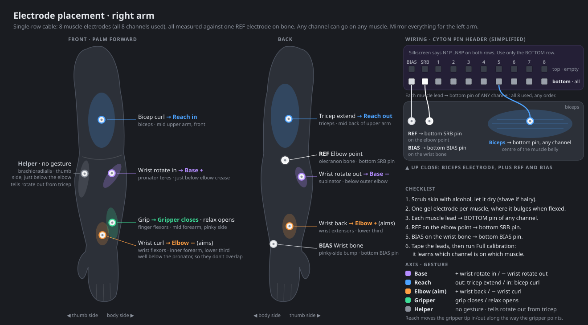

# EMG Arm

Drive a simulated 4-axis wall-mounted robot arm with forearm/upper-arm muscle
signals from an OpenBCI Cyton. The arm sticks straight out of the wall. Its base
is a two-axis gimbal: yaw (left/right), then pitch (up/down). After that come an
elbow and a wrist, which both bend in the arm's plane, and a gripper on the end. Kinematics, rendering (WebGL2) and the EMG signal chain are Rust
compiled to WASM; the page talks to the Cyton dongle directly via Web Serial.

## Build & run

One-time setup (Windows):

```powershell
winget install Rustlang.Rustup
rustup target add wasm32-unknown-unknown
cargo install wasm-pack
```

Build and serve:

```powershell
wasm-pack build --target web --out-dir www/pkg --no-typescript
python serve.py          # serves www/ on :8080 with caching disabled
```

Open <http://localhost:8080> in **Chrome or Edge** (Web Serial needs a Chromium
browser and a secure context; `localhost` counts).

Tests (parser, filters, pipeline, kinematics): `cargo test`

## Using it

- **Manual**: Q/A base yaw, W/S base pitch, E/D elbow, R/F wrist, or drag the sliders.
  Drag the 3D view to orbit, scroll to zoom.
- **Simulate**: generates a fake Cyton byte stream (DC offsets, 60 Hz hum, noise)
  that goes through the real parser and filters. Holding a joint key "contracts"
  the channel mapped to it, so you can try calibration and mapping with no hardware.
- **Connect**: pick the dongle's COM port. The page resets the board, configures all 8
  channels for EMG (gain 24, bias on, SRB2 per the **Electrodes** setting) and starts streaming.

### First session with electrodes

1. Plug in the dongle (switch on **GPIO6**), turn the Cyton on (**PC** position).
2. Connect, then check that **Packets/s ≈ 250** and the channel bars sit near zero at rest.
3. Click **Full calibration** (about a minute). A guide over the 3D view walks
   through each step with a countdown, a progress bar, a live level meter and
   audio cues: first relax completely (rest floor), then for each muscle **GET
   READY → PULSE → RELAX**. A pulse is light *intention*: tense as if about to
   make the movement, but keep the arm still. That level becomes full speed, so
   later pulses drive the arm without real movement. The schedule runs on the
   board's sample clock, so the cue and the recorded window always line up.
   Each phase shows a live signal check, and that check decides when the phase
   advances:
   - **Rest:** counts only still seconds. All electrodes need contact, and a jump
     on any channel reads as movement.
   - **Pulse:** counts only seconds where the cued muscle is at least 2× its rest.
   - **Relax:** waits until every channel is back near rest.

   The countdown pauses while the signal isn't clean, and only clean samples are
   recorded. A dead electrode can be passed with **Skip this step**. At
   the end each muscle gets a pulse-to-rest ratio; redo a weak one with its
   **Pulse** button.
4. Tune **Threshold** (dead-zone) and **Gain**. Pulsing the + muscle of a pair
   moves the joint one way, the − muscle the other; co-contraction cancels.
   Joints use hysteresis: they start at the threshold and stop at half of it.

## Electrode placement (default mapping)



The same diagram is in the app under **OpenBCI Cyton → Electrode guide**.

The Cyton's silkscreen labels both header rows N1P…N8P. The **bottom** row is each
channel's negative input, the **top** row its positive input. Pick the matching
**Electrodes** option in the app before clicking Connect:

- **Single row · shared REF** (default, standard 10-lead cable): one electrode on each
  muscle belly → **bottom** pin of its channel; **REF** on the elbow point (olecranon)
  → **bottom SRB** pin; **BIAS** on the wrist bone (ulnar styloid) → **bottom BIAS**
  pin. Top row stays empty. The page turns SRB2 on (`x n 060110X`).
- **Pairs · top + bottom** (if you have leads for both rows): two electrodes ~2 cm
  apart along each muscle → top and bottom pin of the same channel; BIAS on bone;
  SRB unconnected. SRB2 off (`x n 060100X`). Pairs reject crosstalk from
  neighbouring muscles better.

| Joint     | + channel                | − channel                    |
|-----------|--------------------------|------------------------------|
| Base yaw  | CH1 pronator teres       | CH2 brachioradialis          |
| Base pitch| CH3 anterior deltoid     | CH4 posterior deltoid        |
| Elbow     | CH5 biceps               | CH6 triceps                  |
| Wrist     | CH7 wrist flexors        | CH8 wrist extensors          |

You can reassign any channel to any joint direction in the **Mapping** table.

## Signal chain (per channel, 250 Hz)

Raw µV → 4th-order Butterworth high-pass 20 Hz → **common-average reference**
(single-row mode: subtract the mean of the channels with contact, cancelling the
hum and noise the shared REF puts on all of them) → wide notches (Q 5, each applied
twice) at mains and its 2nd harmonic → full-wave rectify → 5 Hz low-pass (envelope)
→ normalise between the rest floor and the pulse level (90th percentiles of
each recording) → `input = hysteresis(a+ − a−, threshold) × gain` → joint velocity.

Channels whose input is railed (electrode off) are shown as **off**, left out of
the common average, and read as zero.

### Decoder: pattern vs. per channel

- **Pattern · all channels** (default once calibrated): each sample is explained
  as a non-negative mix of the calibrated movement patterns (synergy
  decomposition by NNLS).
  - Channels are scaled by their resting noise, and offline electrodes are left
    out of the fit.
  - Each movement gets its own intensity (1 = the calibrated pulse), and
    crosstalk is part of each pattern instead of reading as another movement.
  - **Compound movements:** up to two movements drive their joints at once. The
    weaker one only counts if it reaches 35% of the stronger; below that it's
    treated as crosstalk.
  - Opposite movements on one joint net out. A pattern split between, say,
    wrist flexors and extensors gives a small net movement, not the wrong one.
  - Each movement engages at the threshold and holds down to half of it.
  - The **Mapping** table decides which movement drives which joint direction.
  - The overlay over the 3D view shows the movements in play and their intensity.
  - The calibration results list how often each movement was recognised on
    held-out data, and which ones get mixed up.
- **Per channel**: each joint follows its own pair of channels, as before.

**Offline electrodes:** once calibrated, a channel that loses contact is
estimated from the working ones, and shown with a `~` and a dashed bar.
1. The working channels give each movement's probability.
2. The missing channel is then predicted from how it varied with the others,
   within each movement, during calibration.

Both decoders keep running on the estimate. Calibration never uses estimates.

Why: on a single-row setup the 60 Hz hum came in at about 290 µV, identical on
every channel. The board's clock puts it at about 59.9 Hz, where a narrow notch
barely works. The common average plus wide notches brought the resting envelope
from about 42 µV down to 2–4 µV.

## Troubleshooting

- **"No response from the board"**: wrong COM port, or the dongle switch is on RESET.
- **"Dongle answered but the board did not"**: Cyton off or out of range; try
  power-cycling both.
- **Choppy data / low packet rate**: set the FTDI latency timer to 1 ms
  (Device Manager → COM port → Port Settings → Advanced).
- **Bars high at rest**: check skin prep/gel and that BIAS (and REF in single-row
  mode) are attached on bone; recalibrate rest.
- **Board never answers / BOARD_NOT_READY in the OpenBCI GUI, but the dongle reports
  "System is Up"**: the Cyton's main firmware is missing or non-standard. Reflash
  the official Cyton firmware (v3.1.2) through the dongle. To enter the bootloader,
  hold PROG while switching the board OFF → PC; the blue LED blinks.
- **Mains**: switch to 50 Hz outside North America.

## Layout

```
src/arm.rs            wall mount, joint limits, velocity integration, forward kinematics
src/render/           WebGL2 renderer, meshes, orbit camera, arm → parts
src/emg/cyton.rs      33-byte packet parser (resync, drop counting, µV scaling)
src/emg/filter.rs     biquads
src/emg/pipeline.rs   envelope, guided calibration, decoder / channel-pair → joint commands
src/emg/decoder.rs    LDA movement-intention classifier + cross-validation report
src/lib.rs            wasm-bindgen API used by the page
www/                  index.html, main.js (UI), serial.js (Web Serial), simulator.js
```
